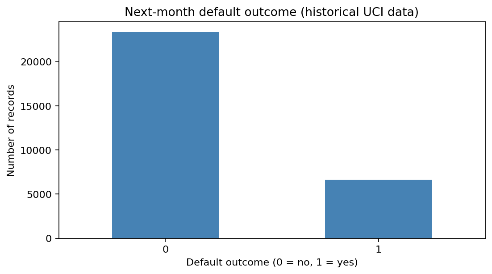
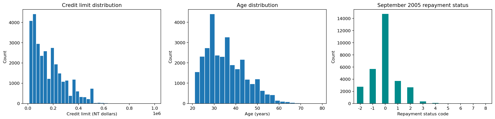
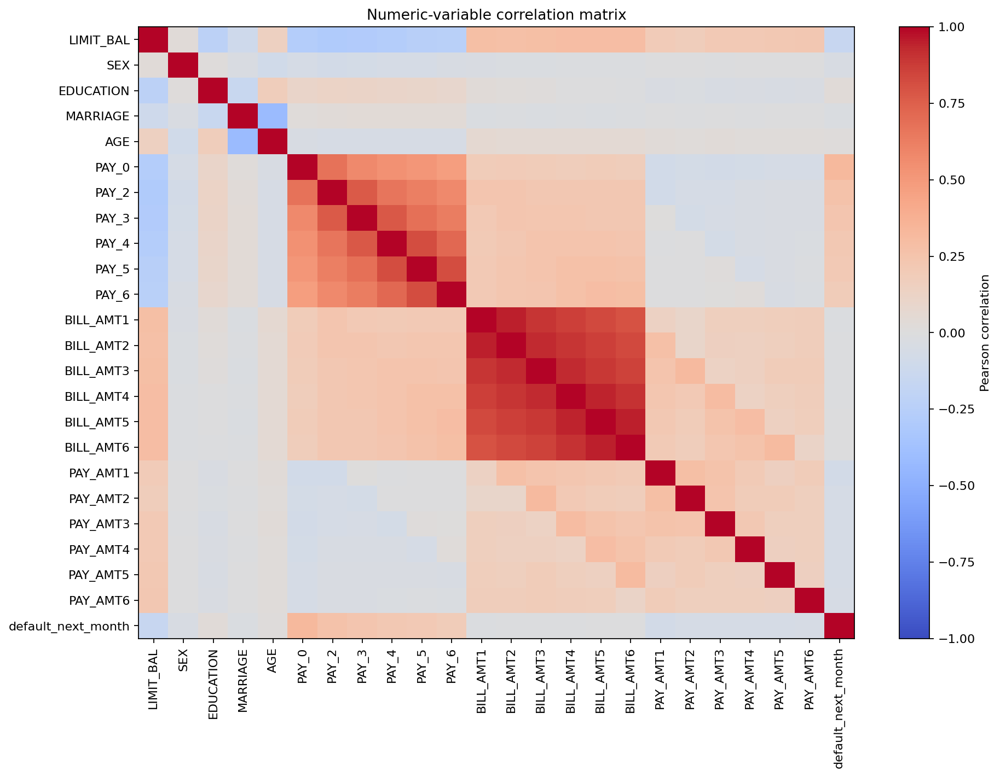
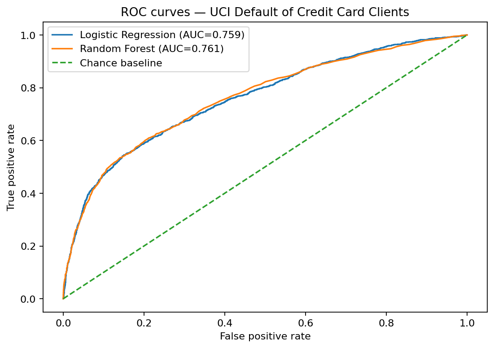
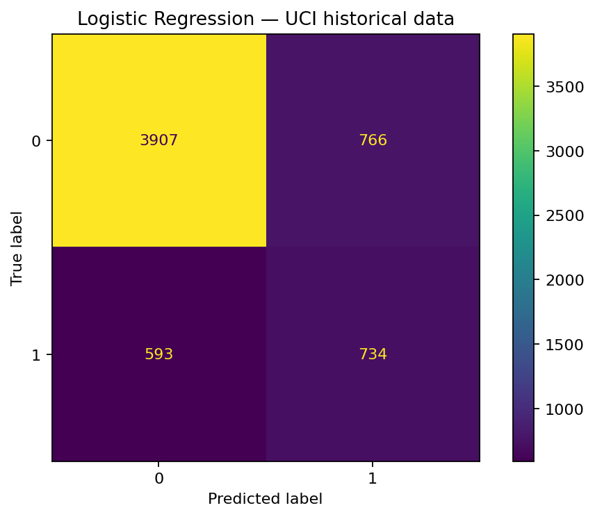
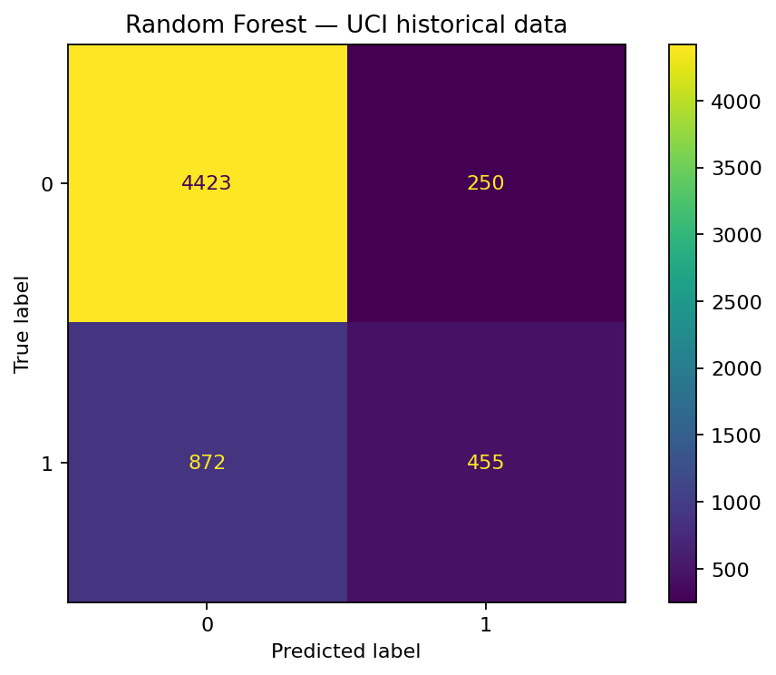

# Credit Risk Analytics & Risk Modelling

A reproducible portfolio project using a **real, publicly documented historical dataset** from the UCI Machine Learning Repository. The project covers exploratory data analysis, preprocessing, baseline classification, evaluation, and responsible interpretation.

> [!IMPORTANT]
> **Educational research only.** The dataset describes credit-card clients in Taiwan and historical outcomes from 2005. This project is not a validated or fair lending decision system and must not be used to approve or reject applicants, set credit limits, or make consequential financial decisions.

## Dataset

**Default of Credit Card Clients** — UCI Machine Learning Repository, dataset ID 350.

- 30,000 historical records and 23 explanatory variables
- Credit limit, demographic codes, repayment history, bill statements, payment amounts, and next-month default outcome
- License: CC BY 4.0 (attribution required)
- Official source: https://archive.ics.uci.edu/dataset/350/defaultofcreditcardclients
- DOI: https://doi.org/10.24432/C55S3H

The dataset is downloaded at runtime through `ucimlrepo`; the raw customer-level data is not stored in this GitHub repository. Internet access is required for the first data fetch.

## Project highlights

- Data quality checks and exploratory data analysis
- Target balance, credit-limit and age distributions, repayment status, and correlation analysis
- Reproducible stratified train/test split
- Preprocessing inside scikit-learn pipelines
- Logistic Regression and Random Forest baselines
- Precision, recall, F1-score, balanced accuracy, ROC-AUC, confusion matrices, and ROC curves
- Dataset card, data dictionary, methodology, and ethics documentation

## Repository structure

```text
credit-risk-analytics/
├── data/                       # Source and acquisition notes; raw data is fetched at runtime
├── docs/
│   ├── dataset_card.md
│   ├── data_dictionary.md
│   ├── methodology.md
│   └── ethics_and_limitations.md
├── notebooks/
│   └── credit_risk_analysis.ipynb
├── src/
│   └── train_model.py
├── reports/
│   └── PROJECT_NOTES.md
├── visualizations/              # Generated charts from notebook/script runs
├── requirements.txt
├── .gitignore
└── README.md
```

## Quick start

Requires Python 3.10+ and internet access to retrieve the UCI dataset.

```bash
git clone https://github.com/rohantyagi2225/credit-risk-analytics.git
cd credit-risk-analytics
python -m venv .venv
```

Activate the environment, then install packages:

**Windows PowerShell**
```powershell
.venv\Scripts\Activate.ps1
pip install -r requirements.txt
python src/train_model.py
```

**macOS/Linux**
```bash
source .venv/bin/activate
pip install -r requirements.txt
python src/train_model.py
```

Or open `notebooks/credit_risk_analysis.ipynb` in Jupyter Notebook or Google Colab and run the cells from top to bottom. The notebook saves charts to `visualizations/`.

## Documentation

- [Dataset card and provenance](docs/dataset_card.md)
- [Data dictionary](docs/data_dictionary.md)
- [Methodology and evaluation plan](docs/methodology.md)
- [Ethics and limitations](docs/ethics_and_limitations.md)

## Modelling notes

The project excludes the row ID from predictors and treats coded demographic and repayment-status variables as categorical in the baseline. Imputation, scaling, and one-hot encoding are fitted inside the training pipeline to reduce leakage. A fixed stratified holdout split is used for reproducibility.

Accuracy is not sufficient on its own. Compare class-specific precision and recall, balanced accuracy, ROC-AUC, and confusion matrices. Metrics must be generated by running the current code; results from different splits or model versions should not be mixed.

## Visual Exploratory Analysis

The following figures are generated by the notebook using the UCI dataset.

### Target distribution



### Feature distributions



### Correlation heatmap



## Model Evaluation Visuals

### ROC curves



### Logistic Regression confusion matrix



### Random Forest confusion matrix



## Model Evaluation and Findings

Two baseline classifiers were evaluated on a stratified 80/20 train-test split of the UCI Default of Credit Card Clients dataset. The test set contains 6,000 records, including 1,327 actual defaults.

| Metric | Logistic Regression | Random Forest |
|---|---:|---:|
| Accuracy | 77% | 81% |
| Default Precision | 0.49 | 0.65 |
| Default Recall | 0.55 | 0.34 |
| Default F1-score | 0.52 | 0.45 |
| ROC-AUC | 0.759 | 0.761 |
| Balanced Accuracy | 0.695 | 0.645 |

### Key Findings

- **Random Forest** achieved higher accuracy and slightly higher ROC-AUC, but detected fewer actual defaults.
- **Logistic Regression** achieved higher default-class recall, default-class F1-score, and balanced accuracy.
- Logistic Regression correctly identified 734 of 1,327 actual defaults, compared with 455 for Random Forest.
- Random Forest generated fewer false-positive default predictions (250 versus 766), but missed more actual defaults (872 versus 593).

### Conclusion

The results demonstrate a trade-off between identifying more potential defaults and reducing false-positive predictions. Logistic Regression performed better on balanced accuracy and default detection recall, while Random Forest had higher precision for the default class and slightly higher ROC-AUC.

These findings are limited to one holdout test split. Further threshold tuning, cross-validation, calibration, temporal validation, and fairness assessment would be required before drawing conclusions about operational suitability.

**Responsible use:** This is an educational analysis of historical Taiwanese credit-card data from 2005. It is not a validated model for present-day lending or consequential credit decisions.

## Limitations

- The data is historical and specific to Taiwan; it should not be assumed to represent current credit applicants or other markets.
- The dataset includes sensitive/proxy attributes. Model performance does not demonstrate fairness.
- The observed target is a historical outcome, not a complete definition of creditworthiness.
- This baseline has not been independently validated, calibrated for operational use, or assessed for regulatory suitability.
- Do not infer causality from correlations or feature effects.

## Dataset attribution

Yeh, I. (2009). *Default of Credit Card Clients* [Dataset]. UCI Machine Learning Repository. https://doi.org/10.24432/C55S3H. Licensed under Creative Commons Attribution 4.0 International (CC BY 4.0).

## Author

**Rohan Tyagi**  
B.Tech, Computer Science and Engineering — Data Science & Machine Learning
